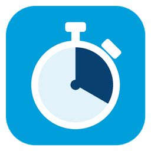

# MUN Timer



A Model UN chair's timer built with raylib and raygui. It runs the general speakers' list, moderated and unmoderated caucuses, motions, roll call and votes, and shows a big clock the whole room can read when the laptop is mirrored to a projector.

---

## Build

Requires CMake 3.22+ and a C23 compiler with `#embed` (GCC 16). The fonts and the icon are compiled into the binary, so the app is a single file.

`third_party/raylib` is a git submodule. After a clone:

```bash
git submodule update --init --recursive
```

Or clone with it already filled in:

```bash
git clone --recurse-submodules <repo url>
```

raygui is the single header in `include/raygui.h`. raylib runs on its GLFW backend and is compiled with the app and linked statically.

On Debian/Ubuntu, raylib needs the X11, OpenGL and ALSA headers:

```bash
sudo apt install build-essential cmake git \
    libgl1-mesa-dev libx11-dev libxcursor-dev libxinerama-dev \
    libxrandr-dev libxi-dev libxext-dev libxfixes-dev libasound2-dev
```

On Fedora:

```bash
sudo dnf install gcc cmake git \
    mesa-libGL-devel libX11-devel libXcursor-devel libXinerama-devel \
    libXrandr-devel libXi-devel libXext-devel libXfixes-devel alsa-lib-devel
```

Configure and compile from the repo root:

```bash
cmake -S . -B build
cmake --build build -j
```

The binary lands at `build/MUNTimer`:

```bash
./build/MUNTimer
```

Default build type on Linux is Debug. For a Release build:

```bash
cmake -S . -B build -DCMAKE_BUILD_TYPE=Release
cmake --build build -j
```

### Tests

The chair logic (time parsing, speakers' lists, motions, the caucus clocks, roll call, undo, saving) is a separate library with no raylib in it, and `mun_tests` checks it:

```bash
ctest --test-dir build --output-on-failure
```

### Windows (MinGW)

Needs CMake 3.22+, MinGW gcc, and `mingw32-make` on `PATH`. From the repo root, in PowerShell:

```powershell
cmake --preset windows
cmake --build --preset windows -j
ctest --preset windows
```

The preset is a Release build and writes `build\MUNTimer.exe`. MinGW's runtime DLLs have to be on `PATH`; it works when launched from a terminal where `gcc` is available.

### Options

| Flag | What it does |
|---|---|
| `--session file` | Save to and restore from `file` instead of `mun_session.txt` |
| `--demo` | Open a sample committee and never write a session file |
| `--screenshot dir` | Render every screen of the sample committee at three window sizes into `dir` as PNGs, then exit |

---

## Chairing with it

### Typing times

Caucus lengths are written the way chairs write them on the board: **total minutes, then the speaking time**.

| You type | It means |
|---|---|
| `9:45` | 9 minutes in total, 45 seconds per speaker: 12 speakers |
| `5:30` | 5 minutes, 30 seconds each: 10 speakers |
| `10:30` | 10 minutes, 30 seconds each: 20 speakers |
| `10:45` | 13 speakers; the 15 seconds left over are dropped |
| `10:1` or `10:2` | a right side under 10 means minutes: 1 or 2 minutes each |
| `10:05` | a leading zero means seconds: 5 seconds each |
| `10:1:30` | 1 minute 30 seconds each |
| `30:10m`, `10m45s`, `10 min 45 sec` | explicit units always win |
| `unmod 7:30` | for an unmod, consultation or extension the colon means minutes and seconds: 7 min 30 s |
| `945` | refused with "Did you mean 9:45?" (a bare number of 100 or more ending in 01 to 59) |

The speaking time on the speakers' list is one time: `1:30`, `90`, `90s` and `1.5` all mean 1 minute 30 seconds (a bare number under 10 is minutes, `05` is 5 seconds).

### Motions

Press **M** and type the motion on one line. A line with the word `unmod` in it is an unmoderated caucus; any other line is a moderated caucus. The line under the box spells out what was understood before you add it.

```
9:45 france accountability           moderated caucus moved by France on "accountability"
france 9:45 accountability           the same: the proposer can come first
unmod 15 usa                         15 minute unmoderated caucus moved by the United States
usa 15 unmod                         the same: "unmod" can go anywhere
rr 45 kenya water                    round robin, 45 s each, starting with Kenya
ext 5                                extend the caucus that just ran by 5 minutes
st 1:30                              set the speaking time to 1:30
consult 10 / intro DR 1.1 / table / close / suspend / adjourn
```

While the line is being typed the roster turns into buttons that fill in the proposer. Proposers can be typed short: `usa`, `uk`, `drc`, `fra` all find the delegation on the roster. If the topic starts with a word that looks like a country, start it with `on`: `mod 9:45 on indo-pacific security`.

Motions are kept in voting order, most disruptive first (HMUN R36, MUNUC, MUNPrep): adjourn, suspend, extend, unmod, consultation, round robin, mod, speaking time, introduce, table, close debate. Longer caucuses go first. Between two mods of the same length, the one with more speakers goes first. Click **Pass** or **Fail** on the motion at the top. Procedural votes count the votes cast: a simple majority is more yes than no, and closing or tabling debate needs twice as many yes as no. When a motion passes, the others are dropped and the caucus is ready to start.

### The moderated caucus clock

The speaker clock is the big one; the caucus total runs behind it and ends the caucus when it runs out. How the total is spent is a setting, because conferences differ:

- **Every speech costs a full slot** (default, HMUN R10). A speech that ends early still uses its whole slot, and a remainder shorter than a slot is dropped. `9:45` is exactly 12 speeches.
- **Only time actually spoken counts.** Short speeches leave time for more speakers. The last speaker gets whatever is left.
- **Runs continuously.** The total keeps running between speakers, like a wall clock.

The proposer speaks first by default (a setting).

### Yields and right of reply

On the general speakers' list, press **Y** for the yield options. *To the chair* ends the speech. *To questions* marks the speech. *To another delegate* gives them the remaining time, and they can't yield again. A right of reply puts the delegation next on the list with 30 seconds.

### Roll call and votes

Press **C** for the roll call. Each delegation is called in turn: **P** present, **V** present and voting, **A** absent. The dialog shows quorum (a third of the members, or a quarter under Harvard rules), simple majority and two-thirds as you go.

Press **V** for a substantive vote on a draft resolution: **Y** yes, **N** no, **A** abstain. Present-and-voting delegations can't abstain. It passes with more yes than no. Under Security Council rules it needs 9 yes and no veto from a permanent member.

### Keyboard

| Key | Action |
|---|---|
| Space | Start or pause the speaker (Page Up on a presenter clicker). In an empty box it leaves the box first |
| N | Next speaker: crosses out the current one (Page Down on a clicker) |
| R | Restart the current speaker's clock |
| Left / Right | Take off or give 10 seconds (with Shift, a minute) |
| Y | Yield / right of reply |
| A | Add speakers: type and press Enter; `fra, ger, bra` adds three, Shift+Enter puts the name next |
| G | During a caucus, add to the general speakers' list instead |
| M or a digit | Type a motion (a digit starts it with its length); E starts an extension |
| X | End the caucus (press twice) |
| C / V / L | Roll call / substantive vote / log and speech counts |
| P or F5 | Presentation view for the projector; B blanks it |
| F11 | Fullscreen |
| Ctrl+Z | Undo the last action |
| Ctrl+S / Ctrl+E / Ctrl+Q | Save now / export the log and speech counts / quit |
| Esc | Leave a text box, close a dialog, leave presentation. It never quits |
| F1 or ? | A summary of the keys and notation |

Letters only act when no text box is being typed in.

### On the projector

The window is laid out to be mirrored, and shows only what the room needs: what the committee is doing, the caucus topic, the speaker and the clock on the left, the speakers' list with crossed-out names and the motions on the right. There are no usage hints and no sounds; the chair keeps time with the gavel. **Presentation** (P or F5) gives the room the whole window: the clock and the list, nothing else. Move the mouse to get Start, Next and Leave buttons. All keys keep working, and B blanks the screen while the clocks keep running.

The clock shows its state with a fill, so it reads even on a washed-out projector:

| State | Shown as |
|---|---|
| Ready | grey digits |
| Speaking | black digits |
| Paused | blue fill, PAUSED |
| Last 10 seconds | amber fill |
| Time | red fill that pulses three times, TIME |
| Overtime | deep red fill, the overtime counting up as `+0:07`, OVERTIME |

The default is raygui's own white look; a dark theme for projectors is in Settings.

### What it saves

Everything is saved as you go to `mun_session.txt` in the folder the app runs from, with the previous save kept as `mun_session.txt.bak`. Opening the app restores the last session, so a crash or a closed lid loses nothing. Clocks come back paused.

Closing the window while a clock runs asks for a second close. **Ctrl+E** writes `mun_log_<date>_<time>.txt`, a timestamped record of motions, votes, caucuses and speeches, and `mun_stats_<date>_<time>.csv`, the speeches and speaking time per delegation, for awards and for spreading the floor fairly.

Delegations go in through **Setup**: search the built-in list of the 193 UN members plus the Holy See and the State of Palestine, type any name (NGOs, crisis characters), paste a list from a spreadsheet, or drop a `.txt` or `.csv` file onto the window.

---

## Layout of the code

| Path | What it is |
|---|---|
| `include/`, `src/text.c` … `src/store.c` | `mun_core`, the chair logic without raylib: `duration` (parsing "9:45"), `clock`, `speakers`, `roster` and `countries`, `motion`, `session`, `chair` (the actions and undo), `store` (saving and exports) |
| `src/ui.c`, `src/view_*.c`, `src/main.c` | The raygui interface |
| `src/assets.c` | The fonts and the icon, compiled in with `#embed` |
| `src/demo.c` | The sample committee behind `--demo` and `--screenshot` |
| `tests/` | `mun_tests` |

## Credits

- [raylib](https://github.com/raysan5/raylib) and [raygui](https://github.com/raysan5/raygui) by Ramon Santamaria, zlib license.
- [Noto Sans](https://github.com/notofonts/latin-greek-cyrillic), SIL Open Font License 1.1 (`data/OFL.txt`).
